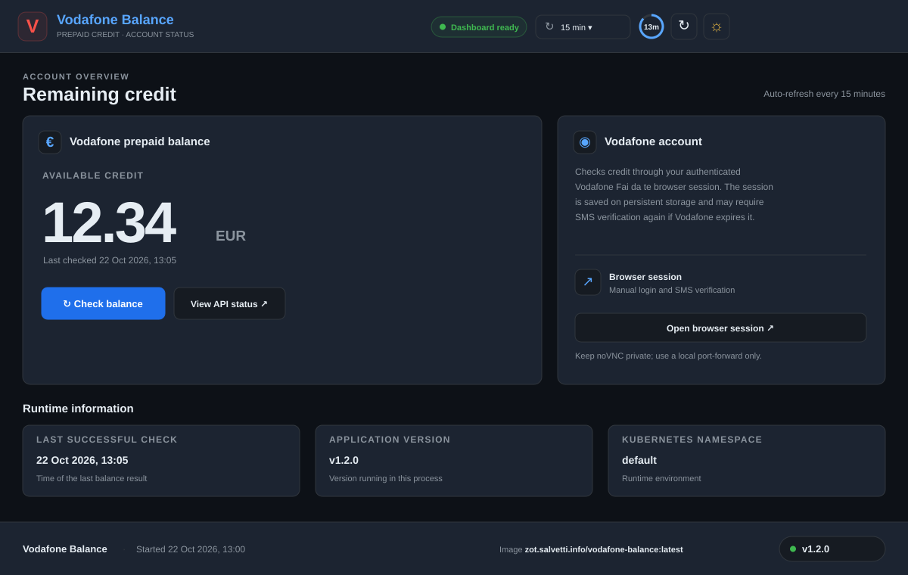
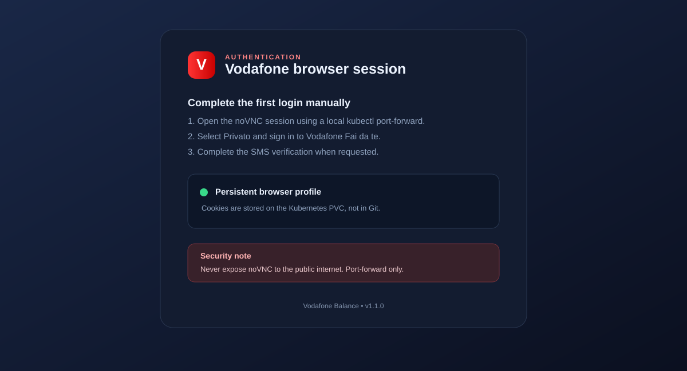

# Vodafone Balance

A self-hosted dashboard for checking the remaining credit on a Vodafone Italy prepaid SIM through the authenticated **Fai da te** website. The browser, its persistent profile, and all application dependencies run inside a container.

## Features

- Responsive dashboard styled to match the top bar, cards, status indicators and bottom bar used by `rk3566-gpu-stress` and `wireguard-monitor`.
- **Dark/light mode** toggle in the top bar; the selected theme is remembered in the browser.
- **Automatic balance refresh** with selectable intervals (off, 5, 10, 15, 30 or 60 minutes), a countdown ring, and a manual refresh button. The setting is remembered in the browser.
- Bottom bar shows the **app name, process startup time, image name:tag and app version**; the version uses the same pill/badge treatment as the reference dashboard.
- Reads the running image from the current Pod object using a dedicated ServiceAccount with read-only Pod access.
- Manual Vodafone login and SMS MFA; the browser profile persists on a PVC.
- HTTP Basic Authentication on the UI and API.

## Clone & build (Linux)

Use the shared [masterlog80/homelab-scripts](https://github.com/masterlog80/homelab-scripts) workflow, as with the other homelab applications. It clones the repository, updates the Docker image metadata/version, builds the image, pushes versioned and `latest` tags to `zot.salvetti.info`, then offers deployment to K3s or Docker Compose based on the host.

```bash
export REPO="masterlog80/vodafone-balance"
export DIRNAME="vodafone-balance"
export REGISTRY="zot.salvetti.info"
export IMAGE_NAME="vodafone-balance"
export COMPOSE_FILE="docker-compose.yml"
export K3S_MANIFEST="deploy/kubernetes.yaml"
export OPERATIONS=""

GH_TOKEN="${GH_TOKEN:-$GITHUB_TOKEN}"
[[ -z "$GH_TOKEN" ]] && read -s -p "GitHub token (required - homelab-scripts is private): " GH_TOKEN && echo
export GH_TOKEN

bash -c "$(curl -fsSL -H "Authorization: token ${GH_TOKEN}" https://raw.githubusercontent.com/masterlog80/homelab-scripts/main/clone-build.sh)"
```

The script requires Docker, curl, Git, and (for the pending pull-request check/version detection) `jq`. It asks for confirmation before pushing each tag and before deployment. Because `homelab-scripts` is private, a GitHub token with permission to read that repository is required.

The Dockerfile version label is the source of the initial version; the shared script proposes the next version based on tags already present in the registry. The Kubernetes manifest uses `zot.salvetti.info/vodafone-balance:latest`.

### Clone & build (Mac)

These instructions build and push a **multi-platform** image from a Mac, so the registry can serve the correct image to both `linux/amd64` and `linux/arm64` hosts. Docker Desktop must be running, and the Mac must be able to reach `zot.salvetti.info`.

The commands below clone the repository locally and build from that directory. If the Linux instructions require repository-specific preparation, perform it after cloning and before building. Do not put credentials or private configuration into the image.

```bash
export REPO="masterlog80/vodafone-balance"
export DIRNAME="vodafone-balance"
export REGISTRY="zot.salvetti.info"
export IMAGE_NAME="vodafone-balance"

git clone "https://github.com/${REPO}.git" "$DIRNAME"
cd "$DIRNAME"

docker buildx inspect mac-multiplatform >/dev/null 2>&1 || docker buildx create --name mac-multiplatform --driver docker-container
docker buildx use mac-multiplatform
docker buildx inspect --bootstrap

VERSION="$(sed -nE 's/.*org.opencontainers.image.version="([^"]+)".*/\1/p' Dockerfile | head -n 1)"
if [ -z "$VERSION" ]; then
  echo "Could not read org.opencontainers.image.version from Dockerfile"
  exit 1
fi

docker buildx build \
  --platform linux/amd64,linux/arm64 \
  --tag $REGISTRY/$IMAGE_NAME:"$VERSION" \
  --tag $REGISTRY/$IMAGE_NAME:latest \
  --push \
  .

docker buildx imagetools inspect $REGISTRY/$IMAGE_NAME:"$VERSION"
```

The manifest should list both `linux/amd64` and `linux/arm64`. Any `unknown/unknown` entries are BuildKit attestation manifests and are expected. This workflow builds and pushes only; it does not deploy the application. Update the deployment through its normal mechanism (for example, FluxCD) after verifying the image.

## Before the first deployment

The Deployment expects a Kubernetes Secret named `vodafone-balance-auth` in namespace `default`, with keys `username` and `password`. Create it before running the shared build/deploy script (the script applies the manifest as part of its deployment step):

```bash
kubectl create secret generic vodafone-balance-auth -n default \
  --from-literal=username='YOUR_UI_USERNAME' \
  --from-literal=password='USE_A_LONG_RANDOM_PASSWORD' \
  --dry-run=client -o yaml | kubectl apply -f -
```

## Kubernetes resources

The manifest deploys into the `default` namespace and creates the ServiceAccount, namespace-scoped Role/RoleBinding, PVC, Deployment and ClusterIP Service. The application ServiceAccount has `get` permission for Pod objects only; it does not have permission to list/watch Pods or read Secrets. The application queries its own Pod by name to display the running image.

## Access the UI and complete Vodafone login

After deployment, forward the UI port:

```bash
kubectl -n default port-forward service/vodafone-balance 8080:8080
```

Open [http://127.0.0.1:8080](http://127.0.0.1:8080) and enter the UI credentials.

In a second terminal, forward noVNC to complete Vodafone login and SMS verification:

```bash
kubectl -n default port-forward deployment/vodafone-balance 6080:6080
```

Open [http://127.0.0.1:6080/vnc.html?autoconnect=true&resize=scale](http://127.0.0.1:6080/vnc.html?autoconnect=true&resize=scale). In the remote browser, select **Privato**, sign in and complete SMS verification. Return to the dashboard and click **Check balance**.

**Security:** noVNC has no separate authentication. Keep port 6080 private and use `kubectl port-forward` only; never expose it through an ingress or public LoadBalancer. The saved browser profile contains session cookies.

## API

The same HTTP Basic Auth credentials protect the API:

```bash
curl -u "$APP_USERNAME:$APP_PASSWORD" -X POST http://127.0.0.1:8080/api/balance
curl -u "$APP_USERNAME:$APP_PASSWORD" http://127.0.0.1:8080/api/status
curl -u "$APP_USERNAME:$APP_PASSWORD" http://127.0.0.1:8080/api/info
```

- `POST /api/balance` attempts to read the current balance and returns JSON.
- `GET /api/status` returns the last reading, error state and runtime metadata.
- `GET /api/info` returns the app name/version, process startup time, namespace and running image.
- `GET /healthz` is an unauthenticated Kubernetes health probe.

## Troubleshooting

- **Login required:** open noVNC, complete Vodafone login/SMS verification, then retry.
- **Balance not detected:** inspect the authenticated page in noVNC. The parser fails rather than guessing if the page changes.
- **Image displays fallback value:** check the ServiceAccount/Role/RoleBinding and the pod logs.
- **ImagePullBackOff:** verify the image was pushed to `zot.salvetti.info/vodafone-balance` and that the cluster can pull it.
- **PVC pending:** check the default StorageClass in K3s.
- **Session expired:** sign in again through noVNC; Vodafone may periodically expire sessions.

## References

- [Vodafone: checking remaining credit](https://www.vodafone.it/privati/area-supporto/pagamenti-controllo-costi/controllo-costi-traffico/controllare-credito-residuo.html)
- [Vodafone: My Vodafone app features](https://www.vodafone.it/privati/area-supporto/applicazioni/myvodafone-app/cosa-posso-fare-dalla-myvodafone-app.html)
- [PrepaidBalance (USSD-based Android app)](https://github.com/mueller-ma/PrepaidBalance)

---

---

## Versioning

The application version and published image tags are managed by this repository's build/release workflow. See the Dockerfile and build instructions for the version source and published tags.

---

## Screenshots

### Main dashboard




### First login / SMS verification



The preview images are illustrative mockups, not captures of a live Vodafone session. The balance and runtime values shown in them are sample data. The running dashboard now includes the matching header controls, persistent dark/light theme, selectable automatic refresh and reference-style footer.

---

## License

This project is licensed under the [MIT License](LICENSE).

---
